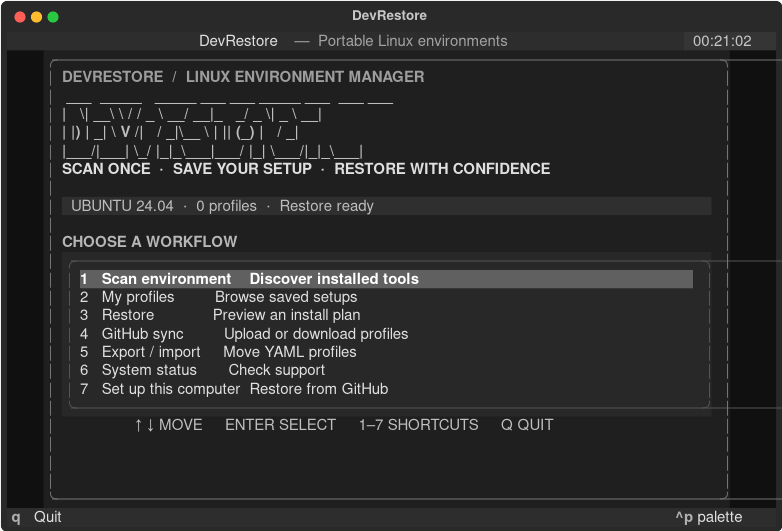
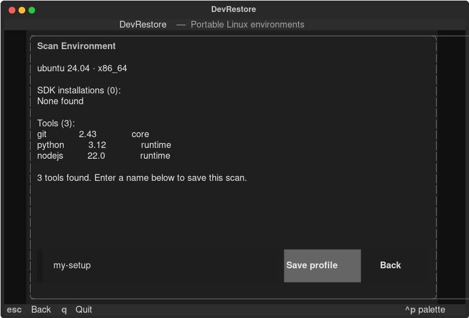
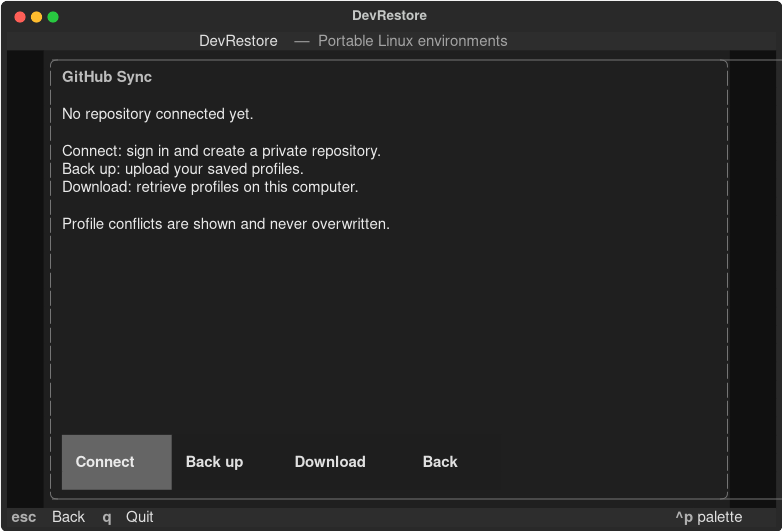
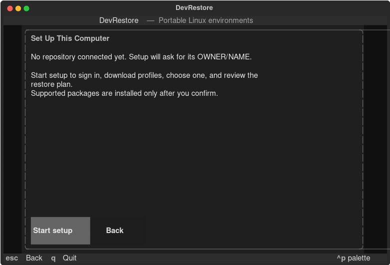

# DevRestore

DevRestore scans known Linux development tools and saves a portable YAML profile. This is an early release with a small, explicit restore package list and optional GitHub backup. Scanning is read-only, and profiles contain tool metadata rather than configuration files or credentials.

## Supported systems

Ubuntu, Debian and Fedora are recognized and supported for the allowlisted APT/DNF restore packages. Scanning can run on other Linux systems, but their distribution family is reported as unknown and package installation is unavailable there.

## Install

Python 3.11 or newer is required. From a copy of this project, install the command with pipx:

```bash
pipx install .
pipx ensurepath
devrestore --help
```

Open a new terminal if `pipx ensurepath` asks you to. For an editable development install instead:

```bash
python3 -m venv .venv
.venv/bin/pip install -e '.[dev]'
.venv/bin/devrestore --help
```

After publication, `pipx install devrestore` will install it without a project checkout.

## Use

```bash
devrestore                         # open the terminal interface
devrestore scan                    # discover allowlisted tools
devrestore scan --profile frontend # filter discovered tools
devrestore scan --profile backend  # includes detected JDK and .NET SDKs
devrestore save --profile work     # save all discovered tools locally
devrestore save --profile devops --filter devops --exclude aws
devrestore save --profile mobile --include-sdk android-sdk --include-sdk flutter-sdk
devrestore profiles
devrestore profile show work
devrestore status --profile work
devrestore restore --profile work --dry-run
devrestore restore --profile work --apply
devrestore export work --output work.yaml
devrestore import work.yaml
devrestore doctor
```

Run `devrestore` without a subcommand to open the full-screen terminal menu. Use the arrow keys and Enter, or press `1`–`7` to open a section; press `q` to quit. The menu shows your distribution and saved profile count. The scan view lets you save a named profile after scanning. GitHub Sync has Connect, Back up, and Download buttons. Set Up This Computer launches the guided GitHub restore flow. The remaining sections show local results or matching CLI commands.

### Move to a new computer using the menu

These screenshots use example scan results. Your tools, versions, and system details will differ.

#### 1. Open the menu on the old computer

Run `devrestore` and choose **Scan environment** (or press `1`).



#### 2. Save a profile

Review the detected tools, type a name such as `my-setup`, and select **Save profile**. The screen confirms when the profile is saved.



#### 3. Create the private GitHub backup

Return to the menu and choose **GitHub sync** (or press `4`). Select **Connect** to sign in and confirm creation of a private repository. The menu temporarily gives the terminal to the sign-in and confirmation prompts. When it returns, select **Back up** and check for `my-setup: uploaded`. Creating the repository alone does not upload the profile.



Remember the repository name (`OWNER/NAME`). On GitHub, you can verify that it contains `profiles/my-setup.yaml`.

#### 4. Start setup on the new computer

Install DevRestore and the GitHub CLI (`gh`), run `devrestore`, and choose **Set up this computer** (or press `7`). Select **Start setup**.



The guided terminal prompts ask for the private repository if it is not already connected, sign in if needed, and let you choose a downloaded profile. DevRestore then shows the current status and restore plan. Review the plan and confirm if you want it to install supported packages; answering **No** is a safe way to test the flow. Profiles with sync conflicts are never overwritten. Unsupported tools and SDKs must be installed separately.

Built-in scan filters are `frontend`, `backend`, `fullstack`, and `devops`. They select only tools actually detected on the machine. `save --include TOOL` and `save --exclude TOOL` can be repeated to customize a profile.

SDK scanning now detects Android SDK installations and common components (platform tools, emulator, build tools, platforms, command-line tools, and NDK), multiple JDK installations, .NET SDK versions, and Flutter installations visible on `PATH`. It reads local SDK metadata and uses the official read-only `dotnet --list-sdks` command. `--include-sdk ID` and `--exclude-sdk ID` select which SDK types to save. SDK paths are shown during scanning but are omitted from portable profiles; versions and Android component metadata are saved. Existing profiles without an `sdks` field still load.

Profiles live in `$XDG_DATA_HOME/devrestore/profiles` (or `~/.local/share/devrestore/profiles`). Existing profiles and export files are never replaced automatically. YAML is parsed with `safe_load`, validated with Pydantic, and restricted to schema version 1. Profile files have user-only permissions. No installation commands are accepted from manifests.

The restore planner supports `git`, `curl`, `wget`, `tmux`, `make`, `gcc`, `cmake`, `vim`, and `zsh` from standard APT/DNF packages. It skips detected tools and reports unsupported tools and SDKs. **SDK restoration is not implemented**; saved SDK entries appear as unsupported in the plan and are never installed. An exact version request is blocked unless that exact version is already installed. `restore` only prints the plan unless `--apply` is supplied. `--non-interactive` also requires `--apply`; no automatic installer fallback is made.

## Optional GitHub backup

Install [GitHub CLI](https://cli.github.com/) (`gh`), then choose **GitHub sync → Connect** in the menu or run the guided connection command. It opens GitHub sign in when needed, then goes straight to creating a private `devrestore-profiles` repository. You can change the name before confirming. DevRestore remembers the repository on this computer:

```bash
devrestore connect
devrestore sync
devrestore sync --direction pull
devrestore setup
```

`connect --repository OWNER/NAME` links an existing private repository instead. Running `connect` again keeps the saved selection. The selected repository is stored in `$XDG_CONFIG_HOME/devrestore/github.json` (or `~/.config/devrestore/github.json`); no GitHub token is stored by DevRestore. Sync only handles `profiles/*.yaml`. It checks that the repository is private, validates downloaded manifests, and reports conflicts without replacing either copy. Creating a repository requires confirmation. `devrestore logout --yes` logs out of the shared GitHub CLI session, which also affects other programs using `gh`.

On a new computer, install DevRestore and `gh`, then run `devrestore setup --repository OWNER/NAME` with the private repository used for backup. This guided command signs in if needed, downloads profiles, lets you choose one, shows its current status and restore plan, and asks before installing supported packages. If the repository was already connected on this computer, `devrestore setup` is enough. Use `--profile NAME` to select a profile directly. Conflicting profiles are never overwritten or restored by this workflow.

The scanner uses `shutil.which` and invokes only predefined arguments for known tools. It does not inventory every OS package, infer reliable installation sources, back up configuration content, or collect secrets. Package-manager inventory, configuration backups, SDK and version-manager restoration, and fuller TUI workflows are planned.

## Development

```bash
.venv/bin/pytest
.venv/bin/ruff check .
.venv/bin/ruff format --check .
```

Contributions are welcome through issues and pull requests. Tests should mock subprocess interactions and must never install system packages.

See [architecture](docs/architecture.md) and [security notes](docs/security.md) for current boundaries.

